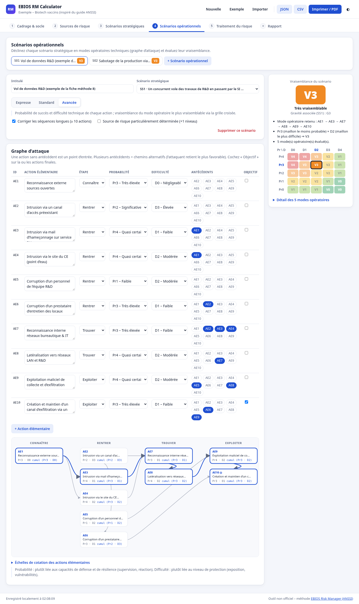
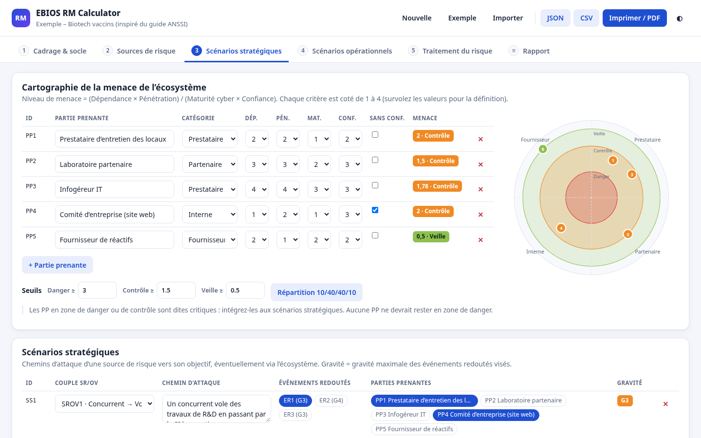
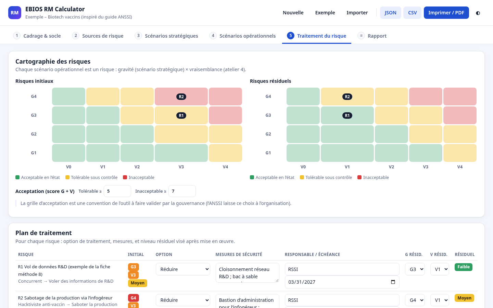

# EBIOS RM Calculator

Outil web d'aide à l'analyse de risques cyber selon la méthode **EBIOS Risk Manager** de l'ANSSI.
Il couvre les **5 ateliers** de la méthode et calcule la vraisemblance des scénarios opérationnels
à partir d'un **graphe d'attaque**, en appliquant les règles des fiches méthodes officielles.

100 % statique : aucune donnée ne quitte le navigateur (sauvegarde locale + export de fichiers).

| Atelier 4 : graphe d'attaque et vraisemblance | Atelier 3 : menace de l'écosystème | Atelier 5 : cartographie des risques |
|---|---|---|
|  |  |  |

> Démo en ligne : _à venir (GitHub Pages)_

## Fonctionnalités

| Atelier | Ce que fait l'outil |
|---|---|
| **1. Cadrage et socle de sécurité** | Valeurs métier, biens supports, événements redoutés cotés en gravité (G1 Mineure → G4 Critique), référentiels du socle avec état d'application et écarts. |
| **2. Sources de risque** | Couples source de risque / objectif visé, pertinence indicative (motivation × ressources), sélection des couples retenus. |
| **3. Scénarios stratégiques** | Niveau de menace des parties prenantes `(Dépendance × Pénétration) / (Maturité cyber × Confiance)`, zones danger / contrôle / veille (seuils réglables ou répartition ANSSI 10/40/40/10), radar SVG, scénarios stratégiques dont la gravité est celle du pire événement redouté visé. |
| **4. Scénarios opérationnels** | Graphe d'attaque éditable (actions élémentaires, phases Connaître / Rentrer / Trouver / Exploiter, antécédents, actions finales), méthodes **expresse**, **standard** et **avancée**, visualisation du mode opératoire retenu, grille croisée, détail de tous les modes opératoires. |
| **5. Traitement du risque** | Un risque par scénario opérationnel, cartographies initiale et résiduelle, plan de traitement (option, mesures, responsable, échéance, niveau résiduel). |
| **Rapport** | Synthèse imprimable / export PDF via le navigateur, exports **JSON** (étude complète) et **CSV** (registre des risques, compatible Excel FR). |

Autres points : sauvegarde automatique (localStorage), import JSON validé et normalisé (valeurs hors échelle corrigées, références cassées retirées, migration de l'ancien format v2), contrôles de cohérence par atelier, thème clair/sombre, aucune dépendance CDN.

## Règles de calcul (atelier 4)

Échelles à 5 niveaux (0 à 4), conformément à la fiche méthode 8 :
probabilité de succès `Pr0` (< 3 %) → `Pr4` (> 90 %), difficulté technique `D0` négligeable → `D4` très élevée,
vraisemblance `V0` invraisemblable → `V4` quasi certain.

**Indices cumulés intermédiaires**, calculés de proche en proche sur le graphe :

```
Pr(AEn)   = Min { Pr(AEn),   Max( Pr cumulés des antécédents ) }
Diff(AEn) = Max { Diff(AEn), Min( Diff cumulées des antécédents ) }
```

Dans une séquence, le maillon le moins probable et le plus difficile s'imposent. Entre chemins
alternatifs, l'attaquant retient le plus probable et le plus facile.

- **Standard** : vraisemblance = indice global de probabilité de succès (meilleur mode opératoire).
- **Avancée** : chaque mode opératoire (chemin d'un point d'entrée à une action finale) est évalué
  avec la grille croisée ci-dessous ; on retient le **mode le plus vraisemblable**. L'outil évite
  volontairement de croiser la probabilité d'un mode avec la difficulté d'un autre, ce qui
  surestimerait la vraisemblance (mise en garde de la fiche méthode).
- **Expresse** : cotation directe, ou croisement probabilité × difficulté globales.
- Options proposées par l'ANSSI : correction des séquences longues (≥ 10 actions : −1 Pr, +1 D) et
  majoration d'un niveau si la source de risque est particulièrement déterminée.

| Pr \ D | D0 | D1 | D2 | D3 | D4 |
|---|---|---|---|---|---|
| **Pr4** quasi certaine | 4 | 4 | 3 | 2 | 1 |
| **Pr3** très élevée | 4 | 3 | 3 | 2 | 1 |
| **Pr2** significative | 3 | 3 | 2 | 2 | 1 |
| **Pr1** faible | 2 | 2 | 2 | 1 | 0 |
| **Pr0** très faible | 1 | 1 | 1 | 0 | 0 |

L'étude d'exemple reprend le graphe d'attaque de la fiche méthode 8 (cas « biotech vaccins ») et
retrouve l'indice global de 3 (V3) publié par l'ANSSI. Ce cas sert aussi de test unitaire.

**Socle de sécurité** : en EBIOS RM, le socle (atelier 1) n'est pas un coefficient appliqué à la
vraisemblance. Les mesures existantes se traduisent dans la cotation de la probabilité et de la
difficulté de chaque action. Un champ « justification / mesures existantes » est prévu pour chaque action.

**Acceptation du risque** (atelier 5) : par défaut, `score = gravité + vraisemblance`.
Le risque est tolérable sous contrôle à partir de 5 et inacceptable à partir de 7. C'est une
convention de l'outil, réglable dans l'interface : l'ANSSI laisse ce choix à la gouvernance.

## Lancer le projet

Prérequis : Node.js ≥ 18.

```bash
npm install
npm run dev       # http://localhost:5173
npm test          # tests unitaires (Vitest)
npm run build     # build statique dans dist/ (chemins relatifs, déployable partout)
npm run preview   # sert le build sur le port 5173
```

Le workflow `.github/workflows/ci.yml` lance les tests et le build, puis publie `dist/` sur
GitHub Pages à chaque push sur `main`. Il faut d'abord activer Pages (source : GitHub Actions).

## Structure

```
src/
  core/          logique métier pure, testée (aucun accès au DOM)
    scales.js    échelles et grilles ANSSI
    ebios.js     moteur de calcul (ateliers 2 à 5)
    model.js     modèle d'étude, validation/normalisation, migration, dérivation des risques
    export.js    exports JSON / CSV
    exemple.js   étude d'exemple
  ui/            rendu (helper DOM sans innerHTML, composants, une vue par atelier)
  store.js       état + persistance locale
tests/           tests unitaires du moteur et du modèle
```

## Références

- ANSSI, [La méthode EBIOS Risk Manager](https://cyber.gouv.fr/la-methode-ebios-risk-manager) et [le guide](https://messervices.cyber.gouv.fr/guides/ebios-risk-manager-la-methode)
- ANSSI, [Fiche méthode 8 – Évaluer la vraisemblance des scénarios opérationnels](https://messervices.cyber.gouv.fr/documents-guides/Fiche_methode-Evaluer_la_vraisemblance_des_scenarios_operationnels-atelier_4.pdf)
- ANSSI, [Fiche méthode – Dangerosité des parties prenantes de l'écosystème](https://messervices.cyber.gouv.fr/documents-guides/Fiche_methode-Construire_lestimation_de_la_dangerosite_des_parties_prenantes_de_l_ecosysteme-atelier_3.pdf)
- [Club EBIOS – FAQ](https://club-ebios.org/site/faq/)

## Avertissement

Outil personnel et pédagogique, **non officiel et non labellisé par l'ANSSI**. Il structure et
accélère une analyse EBIOS RM, mais ne remplace pas un travail collaboratif mené avec les métiers.
Les cotations restent le jugement du groupe de travail. Aucune garantie n'est donnée sur
l'adéquation des résultats à un contexte réel.
